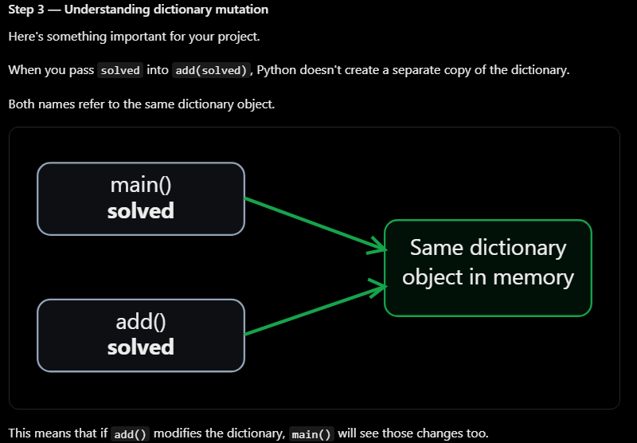

# LeetCode Tracker CLI
A python command-line application for tracking LeetCode problems and reviewing previously solved problems.

## Features
- Add and remove LeetCode problems
- Track problems currently in progress
- Randomly select previously solved problems for review
- Save progress using JSON (planned)

## Technologies
- Python 3
- JSON for persistent storage
- Git and GitHub for version control

## Project Status
Work in progress. Currently implementing problem management and data persistence.

## New things I learned:
```lambda``` functions
```
def greet(name):
    print(f"Hello, {name}!")

def goodbye():
    print("Goodbye!")

name = "Lucas"

actions = {
    "1": lambda: greet(name),
    "2": goodbye
}

action = actions.get("1")

if action:
    action()
``` 
The lambda acts as a wrapper takes no argument itself, but calls ```greet(name)``` when executed.


- JSON Persistence